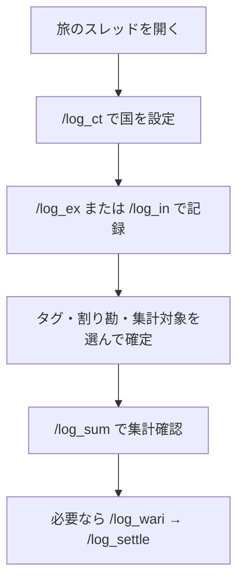

# TabiLog Bot 使い方ガイド

初めて使う人向けの操作説明です。  
セットアップ（Bot起動・Northflank）は [README](../README.md) を見てください。  
ここでは **Discord上での使い方** だけを説明します。

---

## まず覚えること（3つだけ）

| やりたいこと | 打つコマンド |
|---|---|
| 国を設定する | `/log_ct` |
| お金を記録する | `/log_ex`（支出） / `/log_in`（個人予算） |
| 合計を見る | `/log_sum` |

これ以外は「あとで便利なコマンド」です。

---

## コマンドの役割（どれを見るか）

| 見たいもの | 使うコマンド | 注意 |
|---|---|---|
| 国別・全体の共有支出（公式） | `/log_all` ① | 集計対象ON。過去の国別合計はここ |
| 現金の参考合計 | `/log_sum` + 国指定 | ON+OFF・両替除外。公式ではない |
| 自分の実質負担・個人残高 | `/log_sum` または `/log_all` ③ | 割り勘等分込み。÷2はしない |
| 割り勘の「今の」送金 | `/log_wari` | ライブ計算 |
| 建て替えの確定値 | `/log_settle` → `/log_settle_ls` | 保存したスナップショット |

### 被りやすいもの

| 組 | 違い |
|---|---|
| `/log_sum` と `/log_all` | sum=自分だけ・絞り込み。all=みんな向けサマリー |
| `/log_in` と共有支出 | `/log_in` は**実行者の個人予算**。共有の国別支出とは別 |
| `/log_memo` と集計対象OFFの `/log_ex` | memo=本人専用タブ。ex OFF=共有Logに残すが全体集計から外す |
| `/log_wari` と `/log_settle` | wari=毎回再計算。settle=その時点を正式保存 |

---

## 単独運用（はる1人決済）の進め方

1. `.env` の `DEFAULT_SPLIT_PARTICIPANT_IDS` を空にする（割り勘の既定参加者なし）
2. 本日までの精算を `/log_wari` で確認し、`/log_settle` で確定保存
3. 以後の支出は原則「割り勘なしで確定」（決済者=はる）
4. 予算は `/log_in`（自動で自分の個人予算になる）
5. 国別・全体の過去支出は `/log_all` ①のまま（Logは分割しない）

---

## 全体の流れ



---

## ステップ1: 国を設定する

旅ごとにスレッド（またはチャンネル）を作り、そこで国を固定します。

1. そのスレッドで `/log_ct` を打つ
2. `国` に例: `タイ` と入れる
3. 「通貨: **THB**」のように表示されればOK

```text
/log_ct  国: タイ
→ ✅ このスレッド/チャンネルを「タイ」に固定しました
   通貨: THB
```

### ポイント

- **スレッド単位**で設定されます（親チャンネルには影響しません）
- 国を設定しておくと、あとで金額だけ入力しても通貨が自動で入ります
- `/log_ct` なし＋通貨空欄のときは、国名を書いても **円（JPY）** になります（為替換算なし）

---

## ステップ2: 支出を記録する

1. `/log_ex` を打つ
2. 入力フォームが開く

| 欄 | 入力例 | メモ |
|---|---|---|
| 金額 | `250` | 必須 |
| 通貨 | 空欄 または `THB` | 空欄＋`/log_ct` あり → その通貨。ctなし → 円 |
| 国 | 空欄 または `タイ` | 任意。`/log_ct` ありなら ct 優先 |
| 日時 | そのまま／直す | デフォルトは今 |
| メモ | `カフェ` | 任意 |

3. 送信すると記録が作られ、続けてオプション画面が出ます

### オプション画面

| ボタン | 意味 |
|---|---|
| 集計対象 ON/OFF | `/log_sum` 全体・`/log_all` ①に含めるか |
| 割り勘ありで確定 | 支払者＋参加者を保存 |
| 割り勘なしで確定 | 普通の支出として確定（単独運用の通常） |

### 集計対象

| 設定 | 向いている記録 |
|---|---|
| **OFF（デフォルト）** | 日常の現金出費など、全体集計から外したいもの |
| **ON** | カード払いなど、旅の総額に入れたいもの |

- `/log_sum` 未指定 → 集計対象ONのみ
- `/log_sum` 国/タグ指定 → ON+OFF
- 国指定時はタグ「両替」を除外（`tag: 両替` 明示時は残す）
- 国指定の sum は現金参考。公式の国別は `/log_all`

### 割り勘ありのとき

1. **支払者**を1人選ぶ
2. **参加者**を選ぶ（支払者以外だけでも可）
3. 「割り勘ありで確定」

負担者は**参加者のみ**。支払者が参加者に入っていなければ参加者が全額負担（立て替え）。

---

## ステップ3: 個人予算を記録する

1. `/log_in` を打つ
2. 金額・通貨・日時・メモを入力
3. タグと集計対象を選んで「確定」

- 予算は **実行者の個人予算**（`予算ユーザーID`）として保存されます
- 所有者が空の旧予算は「共有予算」扱い（`/log_all` ①の参考残高用）

---

## ステップ3.5: 自分用の買い物メモ

| コマンド | 内容 |
|---|---|
| `/log_memo` | 金額・通貨・国・メモを記録 |
| `/log_memo_ls` | 自分のメモ一覧・合計 |
| `/log_memo_rm` | メモIDを指定して削除 |

Sheets の `Memos` タブ。デフォルト集計対象 OFF。

---

## ステップ4: 集計・一覧・精算

| コマンド | 見える人 | 内容 |
|---|---|---|
| `/log_sum` | 自分だけ | 共有支出合計＋個人実質負担・個人予算・個人残高 |
| `/log_ls` | 自分だけ | 直近20件 |
| `/log_all` | みんな | ①共有 ②メモ ③実質負担 ④建て替え確定 |
| `/log_wari` | みんな | 割り勘ライブ精算 |
| `/log_settle` | みんな | ライブ結果を建て替え確定として保存 |
| `/log_settle_ls` | みんな | 最新の確定スナップショット再表示 |

### `/log_all` の見方

```text
① MEMO抜き … 共有・集計対象ONの支出/予算/国別（過去の公式数字）
② ユーザー別メモ
③ 自分の実質負担・個人予算・個人残高（÷2しない）
④ 建て替え確定（最新スナップショット）
```

---

## 修正・削除

| コマンド | 使い方 |
|---|---|
| `/log_ed` | ID指定→項目選択（予算の所有者も変更可） |
| `/log_rm` | IDを複数まとめて削除可 |

---

## タグの管理

| コマンド | 内容 |
|---|---|
| `/log_tag_ls` | 一覧 |
| `/log_tag_add` | 追加 |
| `/log_tag_rm` | 削除 |

初期: `飯` `移動` `宿` `観光` `買い物` `両替` `その他`

---

## コマンド早見表

| コマンド | 一言 |
|---|---|
| `/log_ct` | 国に紐付け |
| `/log_ex` | 支出 |
| `/log_in` | 個人予算 |
| `/log_memo` / `ls` / `rm` | 買い物メモ |
| `/log_sum` | 集計（共有＋個人） |
| `/log_ls` | 一覧 |
| `/log_all` | 全体サマリー |
| `/log_wari` | 割り勘（ライブ） |
| `/log_settle` / `ls` | 建て替え確定 |
| `/log_ed` / `/log_rm` | 修正・削除 |
| `/log_tag_*` | タグ |

---

## よくあるつまずき

| 症状 | 確認すること |
|---|---|
| 全部円になる | `/log_ct` 済みか。ctなし＋通貨空は円が仕様 |
| 個人残高が予算と合わない | `/log_in` 後の予算か。所有者なし旧予算は個人に入らない |
| `/log_all` ③が÷2 | 古いBot。再デプロイ後は実質負担表示 |
| 建て替えが毎回変わる | `/log_settle` で確定し、`/log_settle_ls` で見る |
| `/log_sum` が他人に見えない | 仕様（自分だけ） |

---

## おすすめ（旅中・単独）

1. 国ごとにスレッドを作り `/log_ct`
2. 大きな出費 → `/log_ex`（集計対象ON・割り勘なし）
3. 現金の細かい出費 → 集計対象 OFF または `/log_memo`
4. 予算投入 → `/log_in`
5. 夜に `/log_sum` で個人残高
6. 同行者クローズ時は `/log_wari` → `/log_settle`
