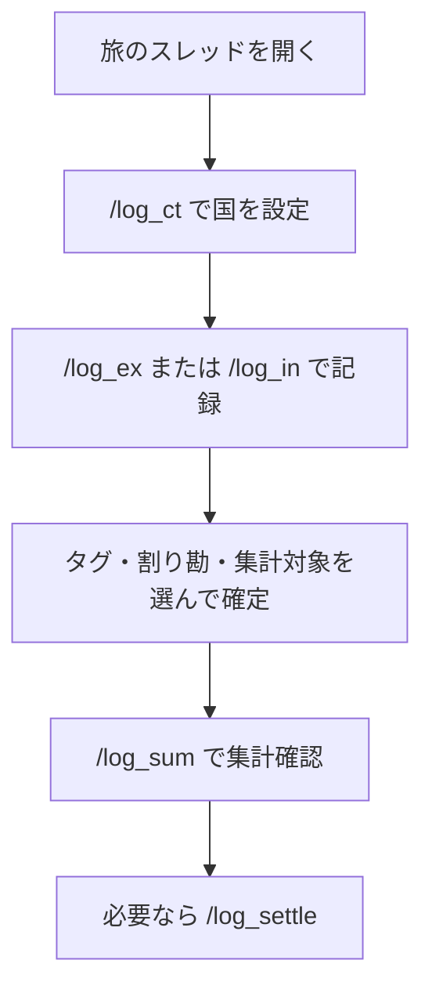

# TabiLog Bot 使い方ガイド（personal / 単独運用）

初めて使う人向けの操作説明です。  
セットアップ（Bot起動・Northflank）は [README](../README.md) を見てください。  
ここでは **Discord上での使い方** だけを説明します。

このブランチでは `/log_wari` は廃止です。精算は `/log_settle` 系を使います。  
Botの返信はメンション（ping）しません。

---

## まず覚えること（3つだけ）

| やりたいこと | 打つコマンド |
|---|---|
| 国を設定する | `/log_ct` |
| お金を記録する | `/log_ex`（支出） / `/log_in`（個人予算） |
| 合計を見る | `/log_sum` / `/log_all` |

---

## コマンドの役割（どれを見るか）

| 見たいもの | 使うコマンド | 注意 |
|---|---|---|
| 国別支出（公式） | `/log_all` ① | 集計対象ON。共有の支出・予算・残高は出さない |
| 現金の参考合計 | `/log_sum` + 国指定 | ON+OFF・両替除外。公式ではない |
| 自分の実質負担・個人残高 | `/log_sum` または `/log_all` ③ | 割り勘等分込み。÷2はしない |
| 建て替えの確定値 | `/log_settle` → `/log_settle_ls` | 保存したスナップショット |
| 確定値の修正 | `/log_settle_ed` | 管理者のみ。AuditLogに残る |

### 被りやすいもの

| 組 | 違い |
|---|---|
| `/log_sum` と `/log_all` | sum=自分だけ・絞り込み。all=みんな向けサマリー |
| `/log_in` と共有支出 | `/log_in` は**実行者の個人予算**。国別支出とは別 |
| `/log_memo` と集計対象OFFの `/log_ex` | memo=本人専用タブ。ex OFF=共有Logに残すが全体集計から外す |
| （旧）`/log_wari` | **廃止**。確定は `/log_settle` |

---

## 単独運用（はる1人決済）の進め方

1. `.env` の `DEFAULT_SPLIT_PARTICIPANT_IDS` を空にする
2. `ADMIN_USER_IDS` に自分のユーザーIDを入れる
3. `/log_settle` で建て替えを確定保存（直すなら `/log_settle_ed`）
4. 以後の支出は原則「割り勘なしで確定」（決済者=はる）
5. 予算は `/log_in`（自分の個人予算）
6. 国別は `/log_all` ①（Logは分割しない）

---

## 全体の流れ



---

## ステップ1: 国を設定する

1. そのスレッドで `/log_ct` を打つ
2. `国` に例: `タイ` と入れる
3. 「通貨: **THB**」のように表示されればOK

### ポイント

- **スレッド単位**で設定されます
- `/log_ct` なし＋通貨空欄のときは **円（JPY）**

---

## ステップ2: 支出を記録する

1. `/log_ex` → 金額などを入力
2. オプション画面で集計対象・割り勘を選ぶ

| 設定 | 向いている記録 |
|---|---|
| **割り勘なしで確定** | 単独運用の通常 |
| 集計対象 **ON** | 国別（`/log_all` ①）に入れるもの |
| 集計対象 **OFF** | 全体の国別から外したい現金など |

---

## ステップ3: 個人予算を記録する

1. `/log_in` を打つ
2. 金額などを入力 → タグと集計対象を選んで「確定」

- 予算は **実行者の個人予算**（`予算ユーザーID`）として保存
- 所有者が空の旧予算は「共有予算」扱い（個人残高には入らない）

---

## ステップ3.5: 自分用の買い物メモ

| コマンド | 内容 |
|---|---|
| `/log_memo` | 記録 |
| `/log_memo_ls` | 一覧・合計 |
| `/log_memo_rm` | 削除 |

---

## ステップ4: 集計・精算

| コマンド | 見える人 | 内容 |
|---|---|---|
| `/log_sum` | 自分だけ | 共有絞り込み＋個人実質負担・個人予算・個人残高 |
| `/log_ls` | 自分だけ | 直近20件 |
| `/log_all` | みんな | ①国別 ②メモ ③実質負担 ④建て替え確定 |
| `/log_settle` | みんな | 割り勘結果を建て替え確定として保存 |
| `/log_settle_ls` | みんな | 最新確定の再表示（行ID付き） |
| `/log_settle_ed` | 管理者 | 確定行の編集（AuditLog） |
| `/log_admin_ls` | 管理者 | 監査ログ直近 |

### `/log_all` の見方

```text
① 国別支出（集計対象ON）
② ユーザー別メモ
③ 実質負担 / メモ / 個人予算 / 個人残高（予算 − 実質負担 − メモ）
```

建て替え確定の表示は `/log_all` には出しません。`/log_settle_ls` を使ってください。

### `/log_ex`（単独）

支払者・参加者・割り勘の選択はありません。タグと集計対象だけ選んで「確定」します。
---

## 修正・削除

| コマンド | 使い方 |
|---|---|
| `/log_ed` | Log の修正（予算の所有者も変更可） |
| `/log_rm` | Log の削除 |
| `/log_settle_ed` | Settlements 行の修正（管理者） |

---

## タグの管理

| コマンド | 内容 |
|---|---|
| `/log_tag_ls` / `add` / `rm` | 一覧・追加・削除 |

---

## コマンド早見表

| コマンド | 一言 |
|---|---|
| `/log_ct` | 国に紐付け |
| `/log_ex` | 支出 |
| `/log_in` | 個人予算 |
| `/log_memo` / `ls` / `rm` | 買い物メモ |
| `/log_sum` | 集計（共有＋個人） |
| `/log_ls` | 一覧 |
| `/log_all` | 全体サマリー |
| `/log_settle` / `ls` / `ed` | 建て替え確定・再表示・編集 |
| `/log_admin_ls` | 監査ログ |
| `/log_ed` / `/log_rm` | Log修正・削除 |
| `/log_tag_*` | タグ |

---

## よくあるつまずき

| 症状 | 確認すること |
|---|---|
| 全部円になる | `/log_ct` 済みか |
| 個人残高が合わない | `/log_in` 後か。所有者なし旧予算は個人に入らない |
| `/log_settle_ed` が拒否 | `ADMIN_USER_IDS` に自分のIDがあるか |
| `/log_wari` が出ない | 仕様（personal では廃止） |
| `/log_sum` が他人に見えない | 仕様（自分だけ） |

---

## テストコマンド（列挙）

1. `/log_all` … ①が国別のみ、支出/予算/残高なし、メンションなし
2. `/log_settle` … 保存できる
3. `/log_settle_ls` … 行ID付きで再表示
4. `/log_settle_ed` … 金額等変更 → Settlements + AuditLog
5. `/log_admin_ls`
6. `/log_in` → `/log_sum` … 個人予算・実質負担
7. `/log_ex`（集計対象ON）→ `/log_all` ①の国別が増える

---

## おすすめ（旅中・単独）

1. 国ごとにスレッドを作り `/log_ct`
2. 大きな出費 → `/log_ex`（集計対象ON・割り勘なし）
3. 現金の細かい出費 → 集計対象 OFF または `/log_memo`
4. 予算投入 → `/log_in`
5. 夜に `/log_sum` で個人残高
6. 同行者クローズ時は `/log_settle`（必要なら `/log_settle_ed`）
