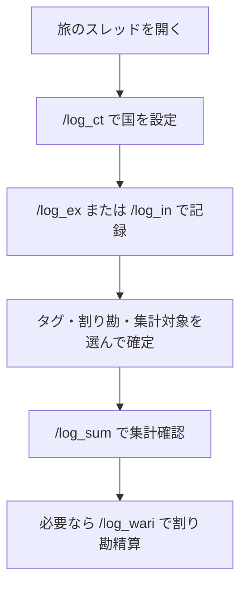

# TabiLog Bot 使い方ガイド

初めて使う人向けの操作説明です。  
セットアップ（Bot起動・Northflank）は [README](../README.md) を見てください。  
ここでは **Discord上での使い方** だけを説明します。

---

## まず覚えること（3つだけ）

| やりたいこと | 打つコマンド |
|---|---|
| 国を設定する | `/log_ct` |
| お金を記録する | `/log_ex`（支出） / `/log_in`（収入） |
| 合計を見る | `/log_sum` |

これ以外は「あとで便利なコマンド」です。

---

## 全体の流れ



---

## ステップ1: 国を設定する

旅ごとにスレッド（またはチャンネル）を作り、そこで国を固定します。

1. そのスレッドで `/log_ct` を打つ
2. `国` に例: `タイ` と入れる
3. 「通貨: **THB**」のように表示されればOK

```text
/log_ct  国: タイ
→ ✅ このスレッド/チャンネルを「タイ」に固定しました
   通貨: THB
```

### ポイント

- **スレッド単位**で設定されます（親チャンネルには影響しません）
- 国を設定しておくと、あとで金額だけ入力しても通貨が自動で入ります
- `/log_ct` なし＋通貨空欄のときは、国名を書いても **円（JPY）** になります（為替換算なし）

---

## ステップ2: 支出を記録する

1. `/log_ex` を打つ
2. 入力フォームが開く

| 欄 | 入力例 | メモ |
|---|---|---|
| 金額 | `250` | 必須 |
| 通貨 | 空欄 または `THB` | 空欄＋`/log_ct` あり → その通貨。ctなし → 円 |
| 国 | 空欄 または `タイ` | 任意。`/log_ct` ありなら ct 優先 |
| 日時 | そのまま／直す | デフォルトは今 |
| メモ | `カフェ` | 任意 |

3. 送信すると記録が作られ、続けてオプション画面が出ます

### オプション画面の見方

```text
┌─────────────────────────────┐
│ タグ（任意・複数可）         │
├─────────────────────────────┤
│ 支払者（割り勘時は必須）     │
├─────────────────────────────┤
│ 参加者（割り勘時・複数可）   │  ← 既定メンバーが入っている場合あり
├─────────────────────────────┤
│ [集計対象: OFF] [割り勘ありで確定] [割り勘なしで確定] │
└─────────────────────────────┘
```

| ボタン | 色の目安 | 意味 |
|---|---|---|
| 集計対象: OFF / ON | 赤 / 緑 | `/log_sum` の全体集計に含めるか |
| 割り勘ありで確定 | 青 | 支払者＋参加者を保存 |
| 割り勘なしで確定 | 灰 | 普通の支出として確定 |

### 集計対象って何？

| 設定 | 向いている記録 |
|---|---|
| **OFF（デフォルト）** | 日常の現金出費など、全体集計から外したいもの |
| **ON** | カード払いなど、旅の総額に入れたいもの |

- `/log_sum` を**何も指定せず**実行 → **集計対象ONだけ**合計
- `/log_sum` に**国やタグを指定** → ON/OFF どちらも含めて合計

### 割り勘ありのとき

1. **支払者**を1人選ぶ
2. **参加者**を確認（既定が入っていればそのまま、足りなければ追加）
3. 「割り勘ありで確定」を押す

Botアカウントは参加者・支払者に使えません。選んでも除外されます。

---

## ステップ3: 収入を記録する

1. `/log_in` を打つ
2. 金額・通貨・日時・メモを入力
3. タグと集計対象を選んで「確定」

割り勘の選択はありません。

---

## ステップ4: 集計・一覧を見る

| コマンド | 見える人 | 内容 |
|---|---|---|
| `/log_sum` | **自分だけ** | 国・タグで絞った集計。円合計・残高（収入−支出）・通貨別も表示 |
| `/log_ls` | **自分だけ** | 直近20件の一覧（ID付き） |
| `/log_all` | みんな | 全体サマリー（国別支出） |
| `/log_wari` | みんな | 割り勘の「誰が誰にいくら」精算（メンションあり） |

### `/log_sum` の例

```text
📊 集計: タイ
支出合計（円）   収入合計（円）   残高（収入 − 支出）
12,000円         50,000円         38,000円
件数: 8件

支出（通貨別）
THB: 2,500 (約12,000円)
```

国やタグを付けた場合は、画面下に  
「国・タグ指定時は集計対象OFFの記録も含みます」と出ます。

---

## 修正・削除

| コマンド | 使い方 |
|---|---|
| `/log_ed` | `id: 23` のように指定 → 現状表示 → 直したい項目を選ぶ |
| `/log_rm` | `ids: 23,24,25` のように複数まとめて削除可 |

直せる項目の例: 日時 / 金額 / 通貨 / タグ / メモ / 国 / 集計対象 / 割り勘 / 支払者 / 参加者

---

## タグの管理

| コマンド | 内容 |
|---|---|
| `/log_tag_ls` | 登録済みタグ一覧 |
| `/log_tag_add` | タグを追加（例: `お土産`） |
| `/log_tag_rm` | タグを削除 |

最初から `飯` `移動` `宿` `観光` `買い物` `その他` が入っています。

---

## コマンド早見表

| コマンド | 一言でいうと |
|---|---|
| `/log_ct` | この場所を国に紐付け |
| `/log_ex` | 支出を記録 |
| `/log_in` | 収入を記録 |
| `/log_sum` | 集計（自分だけ） |
| `/log_ls` | 一覧（自分だけ） |
| `/log_all` | 全体サマリー |
| `/log_wari` | 割り勘精算（メンションあり） |
| `/log_ed` | 記録を修正 |
| `/log_rm` | 記録を削除 |
| `/log_tag_add` / `rm` / `ls` | タグ管理 |

---

## よくあるつまずき

| 症状 | 確認すること |
|---|---|
| 全部円になる | そのスレッドで `/log_ct` 済みか。通貨欄を空にしたか（ctなし＋通貨空は円が仕様） |
| オプション画面が出ない | Botを再起動したか。古いメッセージのボタンを押していないか |
| 割り勘で確定できない | 支払者＋（支払者以外の）参加者が選ばれているか |
| 集計に出てこない | 集計対象が OFF のままになっていないか（全体集計時） |
| `/log_sum` が他人に見えない | 仕様です（自分だけ表示） |

---

## おすすめの使い方（旅中）

1. 国ごとにスレッドを作る（例: `#タイ` `#ベトナム`）
2. 各スレッドで最初に `/log_ct`
3. 現金の細かい出費 → 集計対象 **OFF**
4. カード・大きな出費 → 集計対象 **ON**
5. 夜に `/log_sum` で残高チェック
6. 割り勘が多い日は `/log_wari` で精算
